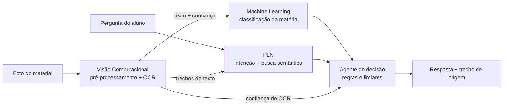
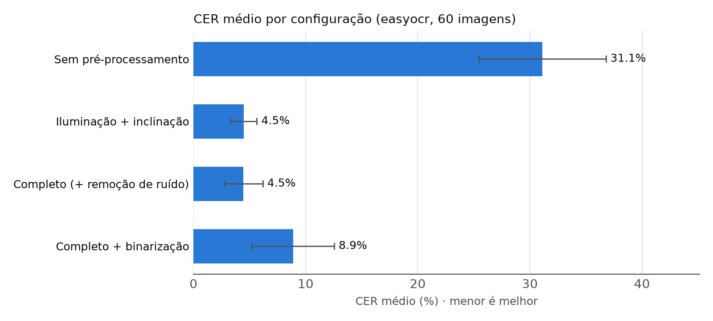
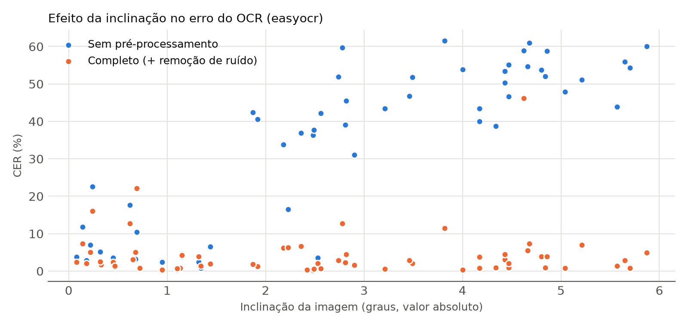
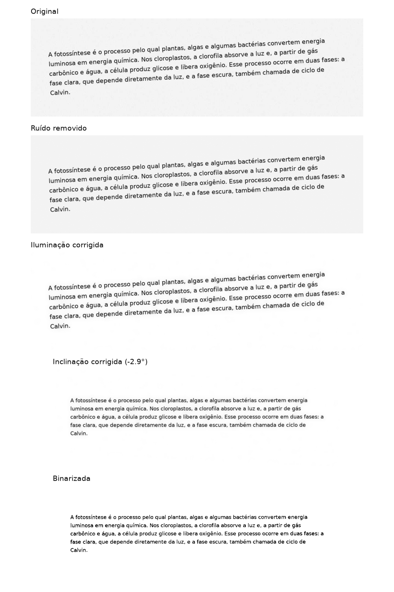

# Assistente Acadêmico Inteligente

Aplicação que lê fotos de material didático (slides, apostilas, páginas de livro) e responde perguntas sobre o conteúdo, sempre indicando o trecho do material de onde a resposta foi tirada.

Projeto Integrador Final da disciplina de Inteligência Artificial, AFYA / UNIMA Maceió.

## Integrantes

| Nome | Responsabilidade |
|---|---|
| _(preencher)_ | Visão Computacional e conjunto de imagens |
| _(preencher)_ | Machine Learning (classificação de assunto) |
| _(preencher)_ | PLN (intenção, busca e resposta) |
| _(preencher)_ | Agente de decisão, interface e integração |
| _(preencher)_ | Experimentos e artigo |

## Problema

Estudantes acumulam fotos de slides e apostilas, mas encontrar uma informação específica nelas exige reler tudo. O assistente transforma essas imagens em texto pesquisável e responde perguntas em linguagem natural com base apenas no material enviado. Quando a resposta não está no material, ele diz isso em vez de inventar.

**Público-alvo:** estudantes de graduação e ensino médio.

## Arquitetura



| Módulo | Pasta | Técnica | Situação |
|---|---|---|---|
| Visão Computacional | `src/visao_computacional/` | OpenCV + OCR (EasyOCR / Tesseract) | Implementado e avaliado |
| Machine Learning | `src/machine_learning/` | TF-IDF + classificadores supervisionados | Planejado |
| PLN | `src/pln/` | Intenção, busca semântica, QA extrativo | Planejado |
| Decisão | `src/decisao/` | Agente baseado em regras | Planejado |
| Interface | `app.py` | Streamlit | Planejado |

## Tecnologias

Python 3.10+ (testado no 3.13), OpenCV, EasyOCR (PyTorch), Tesseract (opcional), NumPy, Pandas, Matplotlib, Pillow e pytest.

Não é necessário ter GPU nem contratar serviços pagos.

## Instalação

```bash
python -m venv .venv
# Windows
.venv\Scripts\activate
# Linux / macOS
source .venv/bin/activate

pip install -r requirements.txt
```

Na primeira execução, o EasyOCR baixa os pesos da rede (cerca de 100 MB) para a pasta `~/.EasyOCR`.

### Tesseract (opcional, para comparar motores de OCR)

- **Windows:** instale pelo instalador da UB Mannheim (<https://github.com/UB-Mannheim/tesseract/wiki>) e marque o idioma **Portuguese** em *Additional language data*.
- **Linux:** `sudo apt install tesseract-ocr tesseract-ocr-por`

## Como executar

```bash
# Ler o texto de uma imagem
python -m src.visao_computacional.ocr caminho/da/imagem.jpg

# Gerar as imagens sintéticas de teste (com gabarito)
python -m src.visao_computacional.gerar_imagens_sinteticas --quantidade 60 --semente 42

# Experimento 1: efeito do pré-processamento no OCR (~30 min em CPU)
python -m src.visao_computacional.experimento_ocr --motor easyocr

# Refazer só os gráficos a partir do CSV salvo
python -m src.visao_computacional.experimento_ocr --so-graficos

# Testes (o marcador "lento" roda o OCR de verdade)
pytest -m "not lento"
pytest
```

## Visão Computacional

### Pré-processamento (`preprocessamento.py`)

Cada etapa trata um defeito comum em fotos de celular:

| Etapa | Problema | Técnica |
|---|---|---|
| Tons de cinza | cor não ajuda a ler texto | conversão BGR → cinza |
| Redimensionamento | letras com poucos pixels | interpolação bicúbica até 1200 px de largura |
| Remoção de ruído | granulado da câmera | Non-Local Means |
| Correção de iluminação | sombras e luz desigual | divisão pelo fundo estimado com fechamento morfológico |
| Correção de inclinação | papel torto | busca do ângulo que maximiza a energia do perfil de projeção horizontal |
| Binarização | separar tinta e papel | limiar de Otsu (ou adaptativo) |

A correção de inclinação é uma busca heurística em duas fases. Primeiro testa ângulos de −10° a +10° em passos de 0,5°, depois refina em passos de 0,05° em volta do melhor. O critério é a soma dos quadrados do perfil de projeção, que é máxima quando as linhas de texto estão na horizontal.

### OCR (`ocr.py`)

Os dois motores têm a mesma interface e podem ser trocados pelo parâmetro `--motor`:

- **EasyOCR (padrão):** detecção de texto com a rede CRAFT e reconhecimento com uma CRNN (CNN + LSTM + CTC), pré-treinadas. Instala só com pip e roda em CPU.
- **Tesseract:** motor LSTM clássico. É mais leve, mas exige instalar o programa no sistema.

### Dados de avaliação

- **Sintéticos (`gerar_imagens_sinteticas.py`):** textos de 6 matérias desenhados com 4 fontes livres e degradações aleatórias: inclinação de ±6°, desfoque, ruído, sombra, baixo contraste e compressão JPEG. O gabarito vem do próprio texto desenhado. Os parâmetros de cada imagem ficam em `metadados.csv`, e a semente fixa garante as mesmas imagens em qualquer computador.
- **Reais (`dados/imagens_reais/`):** fotos de material impresso transcritas manualmente. Veja o [LEIAME](dados/imagens_reais/LEIAME.md).

### Métricas (`avaliacao.py`)

- **CER (Character Error Rate)** e **WER (Word Error Rate)**, calculadas com a distância de Levenshtein. 0 significa leitura perfeita.
- Antes da comparação, os textos passam por normalização Unicode (NFC) e de espaços.

## Resultados

### Experimento 1: efeito do pré-processamento no OCR

EasyOCR em CPU, 60 imagens sintéticas (semente 42). O tempo inclui o pré-processamento e o OCR.

| Configuração | CER médio | CER mediana | WER médio | Tempo médio |
|---|---|---|---|---|
| Sem pré-processamento | 31,1% | 39,0% | 47,5% | 6,6 s |
| Iluminação + inclinação | 4,5% | 3,3% | 20,6% | 7,3 s |
| Completo (+ remoção de ruído) | **4,5%** | **2,4%** | **19,2%** | 7,5 s |
| Completo + binarização | 8,9% | 4,0% | 29,0% | 7,4 s |





**O que os dados mostram:**

- **A correção de inclinação explica quase todo o ganho, mas pela ordem de leitura.** Até cerca de 1,8° de inclinação, o OCR sem pré-processamento já erra pouco. Acima disso, o CER salta para 35–60%. As saídas em `resultados/exemplos/` mostram que o EasyOCR continua reconhecendo os caracteres. O que falha é a reconstrução da ordem de leitura: os segmentos são agrupados em linhas pela altura e, com o texto inclinado, trechos de linhas vizinhas se misturam. Numa linha de ~1.080 px, 2° de inclinação deslocam o fim da linha cerca de 38 px na vertical, mais do que a altura de uma letra.
- **A remoção de ruído ajuda pouco.** O CER médio é o mesmo, a mediana cai de 3,3% para 2,4% e o WER cai de 20,6% para 19,2%. O desvio, porém, aumenta, porque algumas imagens pioram.
- **A binarização piora o EasyOCR** (de 4,5% para 8,9%). A hipótese mais provável é que a rede foi treinada com imagens naturais em tons de cinza, e a binarização remove a informação das bordas das letras. Por isso o pipeline padrão não binariza.
- **Erros que sobram:** confusão entre "o" e "0", troca de pontuação ("." por ":") e omissão de palavras curtas ("e", "a").



**Próximos passos deste módulo:**
1. Reconstruir a ordem de leitura a partir do ângulo das caixas detectadas, para não depender só da correção de inclinação.
2. Avaliar com fotos reais.
3. Comparar o EasyOCR com o Tesseract.

## Limitações conhecidas

- O escopo é material **impresso**. Texto manuscrito, fórmulas matemáticas e diagramas tendem a ter OCR ruim.
- A correção de inclinação supõe texto em linhas horizontais e ângulos de até ±10°. Fotos com perspectiva forte (papel fotografado de lado) não são corrigidas.
- As imagens sintéticas não reproduzem todos os defeitos de fotos reais, como dobras no papel, reflexo e perspectiva. Os resultados do Experimento 1 ainda precisam ser confirmados com fotos reais.
- O OCR em CPU leva cerca de 7 s por imagem, o que é aceitável para a demonstração, mas lento para lotes grandes.

## Estrutura do repositório

```
src/
  visao_computacional/   pré-processamento, OCR, métricas, gerador de imagens, experimento
  machine_learning/      classificação de assunto
  pln/                   intenção, busca e resposta
  decisao/               agente baseado em regras
dados/                   textos-base, imagens sintéticas (geradas) e reais
resultados/              tabelas, gráficos e exemplos dos experimentos
notebooks/               exploração
testes/                  testes automatizados (pytest)
artigo/                  fonte LaTeX do artigo
```

## Referências

- BAEK, Y. et al. Character Region Awareness for Text Detection. *CVPR*, 2019.
- BUADES, A.; COLL, B.; MOREL, J.-M. A non-local algorithm for image denoising. *CVPR*, 2005.
- LEVENSHTEIN, V. I. Binary codes capable of correcting deletions, insertions, and reversals. *Soviet Physics Doklady*, v. 10, n. 8, 1966.
- OTSU, N. A Threshold Selection Method from Gray-Level Histograms. *IEEE Transactions on Systems, Man, and Cybernetics*, v. 9, n. 1, 1979.
- SHI, B.; BAI, X.; YAO, C. An End-to-End Trainable Neural Network for Image-based Sequence Recognition and Its Application to Scene Text Recognition. *IEEE TPAMI*, v. 39, n. 11, 2017.
- SMITH, R. An Overview of the Tesseract OCR Engine. *ICDAR*, 2007.
- JaidedAI. EasyOCR. Disponível em: <https://github.com/JaidedAI/EasyOCR>.

## Artigo

_Link do Overleaf: (preencher)_
